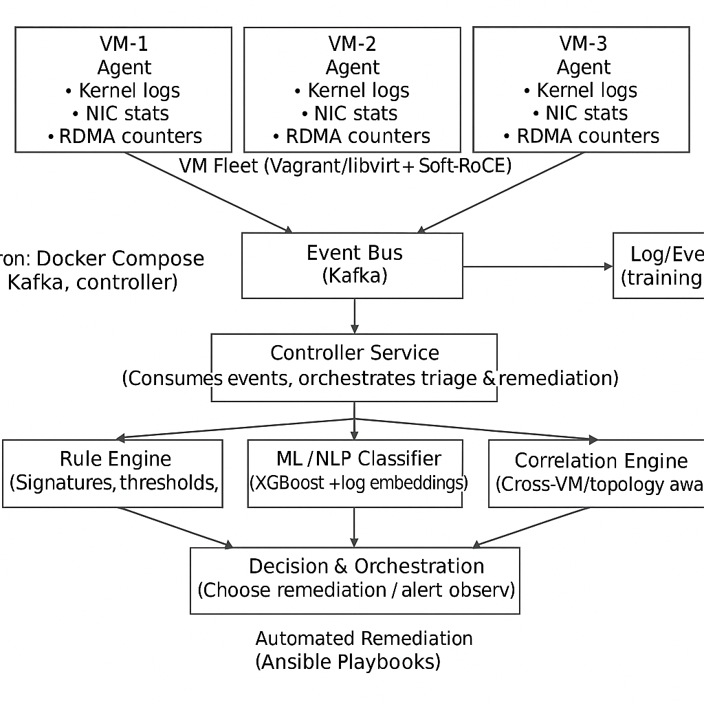

# Network Bug Triage & Remediation Platform

## 📌 Overview
This platform automates **detection, correlation, and remediation** of network issues across a multi-VM environment.  
It integrates **network telemetry (kernel logs, NIC stats, RDMA counters)** with **AI/ML (XGBoost, NLP log parsing)** to:
- Detect kernel, driver, and RDMA errors
- Correlate across a multi-VM topology
- Apply safe remediation (MTU fixes, driver restarts, config rollbacks) via **Ansible**

## 🏗️ Architecture
- **Agent (per VM)**: Collects telemetry → pushes JSON events to Kafka  
- **Controller**: Consumes events → applies rule-based + ML triage → triggers remediation playbooks  
- **Infra**: Multi-VM setup with Vagrant/libvirt + Soft-RoCE for RDMA  
- **ML/NLP**: XGBoost classifier + transformer-based log embeddings

## 🏗️ System Architecture



## 🤖 AI Multi-Agent Layer

On top of the deterministic stack (rules + XGBoost + NLP + Ansible) the platform
runs a **multi-agent, LLM-powered reasoning pipeline**. When the AI extras are
installed the workflow runs on a native **LangGraph `StateGraph`**, the LLM layer
uses **LangChain `ChatVertexAI`** (Google Vertex AI Gemini), and root-cause
analysis can run as a **Google ADK `LlmAgent`**. The XGBoost classifier remains
the **fast first-pass classifier**; the LLM performs the deeper reasoning
(root-cause analysis, explanation, remediation planning and risk analysis).

```
Telemetry Agent → Kafka → Orchestrator (LangGraph StateGraph)
   → Planner Agent → Telemetry Analysis Agent → Retriever Agent
   → Vector DB + Knowledge Base → LangChain ChatVertexAI (Gemini) / Google ADK
   → Root Cause Analysis Agent → Remediation Planner
   → Human Approval → Ansible Execution → Validation Agent → Dashboard
```

### Agents (`controller/ai/agents.py`)
| Agent | Responsibility |
|-------|----------------|
| Planner | Decides analysis depth based on ML priority + rule signals |
| Telemetry Analysis | Extracts structured signals (counters, MTU anomalies) |
| Retriever | Hybrid vector + keyword + incident-history retrieval |
| Knowledge Base | Selects the authoritative runbook |
| Root Cause Analysis | Gemini-grounded RCA over retrieved context (via Google ADK `LlmAgent` when enabled) |
| Remediation | Gemini remediation planning + risk analysis (guardrailed to real playbooks) |
| Validation | Post-remediation before/after validation |
| Audit | Persists incident + remediation to memory |

### Key properties
- **Native LangGraph orchestration** — the workflow compiles a LangGraph
  `StateGraph` over a shared `WorkflowState`, with each agent as a node and
  conditional edges for the escalation branch and the human-approval interrupt.
  If `langgraph` is absent an equivalent sequential executor runs the identical
  nodes (`orchestrator.status()` reports `executor: langgraph | sequential`).
- **Graceful degradation** — the deps in `requirements.txt` (Vertex AI,
  LangChain, LangGraph, ADK) are installed by default. With valid
  `GOOGLE_CLOUD_PROJECT` credentials the LLM backend becomes `vertex-gemini`
  (`impl=langchain-vertex`) and the ADK RCA agent is used; **without cloud
  credentials the layer falls back to a deterministic offline reasoner + numpy
  cosine retrieval**, so the platform still works fully air-gapped (the
  LangGraph executor is used either way).
- **Non-invasive** — the legacy rule/ML/Ansible path is untouched; the AI layer
  augments the decision and is fully optional (toggle via `NBT_AI_ENABLED`).
- **Human approval** — AI-generated remediations are held `pending_approval`
  and executed only after approval via the dashboard/API.
- **Hybrid retrieval** — vector search + keyword search + incident history over
  runbooks, RDMA docs, kernel-log patterns and past remediation records.
- **Memory** — conversation, incident, host-history, remediation-history and
  failure-pattern memory persisted under `controller/ai/store/`.

### Configuration
AI settings live in `controller/ai/ai_config.yaml` and are overridable via
environment variables:

| Variable | Purpose |
|----------|---------|
| `NBT_AI_ENABLED` | Master on/off for the AI layer |
| `NBT_AI_REQUIRE_APPROVAL` | Require human approval before remediation |
| `GOOGLE_CLOUD_PROJECT` / `NBT_VERTEX_PROJECT` | Enables Vertex AI Gemini |
| `NBT_VERTEX_LOCATION`, `NBT_VERTEX_MODEL` | Vertex region / model |
| `GOOGLE_APPLICATION_CREDENTIALS` | Service-account JSON for Vertex |

### API endpoints (Flask)
| Endpoint | Description |
|----------|-------------|
| `GET /api/ai/status` | LLM backend + impl, executor (langgraph/sequential), retrieval, memory & metrics |
| `GET /api/ai/incidents` | Recent multi-agent incidents (RCA + plans) |
| `GET /api/ai/incident/<id>` | Full agent trace for one incident |
| `POST /api/ai/approve` | Approve/reject a pending remediation |

### Evaluation
A reproducible harness measures fault-localization and fault-domain accuracy:

```bash
python -m controller.ai.evaluation --dataset data/eval_labeled.json
```

On the bundled `data/eval_labeled.json` (150 samples) the offline heuristic
backend scores `localization_accuracy = 1.0` and `domain_accuracy = 1.0`. Note
this dataset is **synthetic and self-consistent** (each `dmesg_tail` contains the
keyword the classifier keys on, and localization is scored against the event's
own host), so the score validates the end-to-end pipeline rather than proving a
real-world accuracy figure. Replace it with a labelled production-traffic set
for a representative measurement.

## ▶️ Running

### 1. Python environment
```powershell
.\myenv\Scripts\Activate.ps1      # or create your own venv
pip install -r requirements.txt
```
`bcc` (Linux-only) and `ansible` may fail to install on Windows; comment them out
if you only need the UI / dry-run modes. `sentence-transformers` is optional
(zero-vector embeddings are used if it is missing).

### 2. Backend (pick one)
```bash
python main.py   # FastAPI: http://127.0.0.1:8000  (Swagger at /docs) - used by the React UI
python app.py    # Flask:   http://127.0.0.1:5000  (legacy dashboard)
```

| Variable | Purpose |
|----------|---------|
| `NBT_FASTAPI_HOST` / `NBT_FASTAPI_PORT` | FastAPI bind address (default `127.0.0.1:8000`) |
| `NBT_CORS_ORIGINS` | Extra comma-separated CORS origins |
| `NBT_HOST` / `NBT_PORT` / `NBT_DEBUG` | Flask bind address / debug mode |
| `NBT_SECRET_KEY` | Flask session key (random per process if unset) |

### 3. React frontend (optional)
```bash
cd frontend
npm install
npm run dev      # http://localhost:5173
```
The API URL is read from `frontend/.env` (`VITE_API_BASE_URL`, default `http://127.0.0.1:8000`).

### 4. Pipeline without the UI
```bash
python -m tests.validate_pipeline --mode dry --count 4
python -m tests.test_ai_layer
```

### 5. Kafka mode (requires Docker)
```bash
docker compose up -d                                   # ZooKeeper + Kafka on localhost:9092
python -m controller.processor --kafka localhost:9092  # add --dry-run to skip real Ansible runs
python -m tests.validate_pipeline --mode kafka --kafka localhost:9092 --count 5
```
Without `--dry-run` the processor executes real playbooks against `infra/inventory.ini`
(hosts are commented out by default). UI-triggered remediation is always simulated.

### 6. Agent / multi-VM deployment (Linux)
```bash
python3 agent/agent.py --dry-run --once          # collect one telemetry event
bash infra/create-vm.sh 5 --up                   # Vagrant testbed
ansible-playbook infra/site.yml                  # see docs/ansible.md
```
`tests/inject_faults.sh` is destructive; use it on an isolated testbed only.
