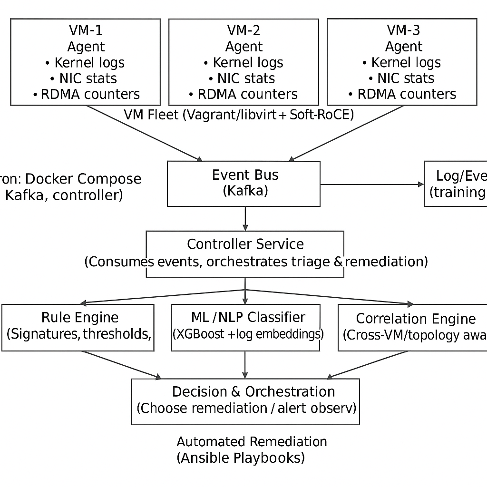

# Network Bug Triage & Remediation Platform

## 📌 Overview
> We turn noisy Linux and RDMA network telemetry into an evidence-backed diagnosis,
> a human-approved fix, and a verified outcome.

The MVP is scoped to **Linux/RDMA interface faults — chiefly MTU mismatches and
driver/network errors** on hosts described in a topology registry. It:
- Collects interface counters, MTU, RDMA QP counters and kernel log lines (agent).
- Triages them with deterministic rules, a log classifier, an optional XGBoost
  model and an optional AI layer.
- Builds **deterministic, topology-aware evidence**: expected vs observed values,
  counter deltas, exact log lines, host/interface/peer localization, path and
  blast radius, and change correlation (correlation only, never proof).
- Sends every remediation candidate (rules, ML, AI, API, Kafka) through **one
  remediation policy**: allowlisted actions, validated targets, a preview, human
  approval, simulation by default, a deterministic post-check and an audit trail.

What it does **not** claim: broad vendor coverage, autonomous production
remediation, or real-world accuracy. All bundled data (demo, golden scenarios,
`data/eval_labeled.json`) is synthetic.

## 🏗️ Architecture
- **Agent (per VM)**: Collects telemetry → pushes JSON events to Kafka  
- **Controller**: Consumes events → rules + ML triage → evidence → remediation *proposals* (never executes directly)  
- **Remediation policy** (`controller/remediation/`): preview → approval → execute (simulate by default) → post-check → audit  
- **Infra**: Multi-VM setup with Vagrant/libvirt + Soft-RoCE for RDMA  
- **ML/NLP**: XGBoost classifier + transformer-based log embeddings (both optional; deterministic fallbacks)

### Event → outcome call graph
```
FastAPI /api/process | /api/inject | demo loader         Kafka → controller.processor.Processor
                 \                                     /
        rules_engine + nlp_parser + triage_model (+ optional AI orchestrator)
                                   |
             controller.evidence.build_evidence (+ controller.topology registry)
                                   |
      controller.remediation.candidates.build_candidates (rules | ml | ai)
                                   |
   RemediationPolicy.propose → stored preview (status pending_approval | blocked)
                                   |
   POST /api/remediations/{id}/decision | POST /api/ai/approve | python -m controller.remediation approve
                                   |
   RemediationPolicy.decide → executor (simulate | ansible, bound at preview) → verify (post-check) → audit
```

## 🏗️ System Architecture



## 🤖 AI Multi-Agent Layer

On top of the deterministic stack (rules + XGBoost + NLP + Ansible) the platform
runs a **multi-agent, LLM-powered reasoning pipeline**. When the AI extras are
installed the workflow runs on a native **LangGraph `StateGraph`**, the LLM layer
uses **LangChain `ChatVertexAI`** (Google Vertex AI Gemini), and root-cause
analysis can run as a **Google ADK `LlmAgent`**. The XGBoost classifier remains
the **fast first-pass classifier**; the LLM performs the deeper reasoning
(root-cause analysis, explanation, remediation planning and risk analysis).

```
Telemetry Agent → Kafka → Orchestrator (LangGraph StateGraph)
   → Planner Agent → Telemetry Analysis Agent → Retriever Agent
   → Vector DB + Knowledge Base → LangChain ChatVertexAI (Gemini) / Google ADK
   → Root Cause Analysis Agent → Remediation Planner
   → Human Approval → Ansible Execution → Validation Agent → Dashboard
```

### Agents (`controller/ai/agents.py`)
| Agent | Responsibility |
|-------|----------------|
| Planner | Decides analysis depth based on ML priority + rule signals |
| Telemetry Analysis | Extracts structured signals (counters, MTU anomalies) |
| Retriever | Hybrid vector + keyword + incident-history retrieval |
| Knowledge Base | Selects the authoritative runbook |
| Root Cause Analysis | Gemini-grounded RCA over retrieved context (via Google ADK `LlmAgent` when enabled) |
| Remediation | Gemini remediation planning + risk analysis (guardrailed to real playbooks) |
| Validation | Post-remediation before/after validation |
| Audit | Persists incident + remediation to memory |

### Key properties
- **Native LangGraph orchestration** — the workflow compiles a LangGraph
  `StateGraph` over a shared `WorkflowState`, with each agent as a node and
  conditional edges for the escalation branch and the human-approval interrupt.
  If `langgraph` is absent an equivalent sequential executor runs the identical
  nodes (`orchestrator.status()` reports `executor: langgraph | sequential`).
- **Graceful degradation** — the deps in `requirements.txt` (Vertex AI,
  LangChain, LangGraph, ADK) are installed by default. With valid
  `GOOGLE_CLOUD_PROJECT` credentials the LLM backend becomes `vertex-gemini`
  (`impl=langchain-vertex`) and the ADK RCA agent is used; **without cloud
  credentials the layer falls back to a deterministic offline reasoner + numpy
  cosine retrieval**, so the platform still works fully air-gapped (the
  LangGraph executor is used either way).
- **Non-invasive** — the AI layer augments the decision and is fully optional
  (toggle via `NBT_AI_ENABLED`). Its remediation plan is only a *candidate* for
  the shared remediation policy; it cannot execute anything.
- **Human approval** — every remediation (rules, ML or AI) is held
  `pending_approval` by the shared policy and executed only after approval.
- **Hybrid retrieval** — vector search + keyword search + incident history over
  runbooks, RDMA docs, kernel-log patterns and past remediation records.
- **Memory** — conversation, incident, host-history, remediation-history and
  failure-pattern memory persisted under `controller/ai/store/`.

### Configuration
AI settings live in `controller/ai/ai_config.yaml` and are overridable via
environment variables:

| Variable | Purpose |
|----------|---------|
| `NBT_AI_ENABLED` | Master on/off for the AI layer |
| `NBT_AI_REQUIRE_APPROVAL` | Require human approval before remediation |
| `GOOGLE_CLOUD_PROJECT` / `NBT_VERTEX_PROJECT` | Enables Vertex AI Gemini |
| `NBT_VERTEX_LOCATION`, `NBT_VERTEX_MODEL` | Vertex region / model |
| `GOOGLE_APPLICATION_CREDENTIALS` | Service-account JSON for Vertex |

### AI API endpoints (FastAPI)
| Endpoint | Description |
|----------|-------------|
| `GET /api/ai/status` | LLM backend + impl, executor (langgraph/sequential), retrieval, memory & metrics |
| `GET /api/ai/incidents` | Recent multi-agent incidents (RCA + plans) |
| `GET /api/ai/incident/<id>` | Full agent trace for one incident |
| `POST /api/ai/approve` | Approve/reject via the shared remediation policy (`approver`, optional `preview_digest`) |

The legacy Flask app (`app.py`) still serves the old dashboard but **refuses
approvals** (HTTP 409), because it is outside the remediation policy boundary.

### Evaluation
A reproducible harness measures fault-localization and fault-domain accuracy:

```bash
python -m controller.ai.evaluation --dataset data/eval_labeled.json
```

On the bundled `data/eval_labeled.json` (150 samples) the offline heuristic
backend scores `localization_accuracy = 1.0` and `domain_accuracy = 1.0`. Note
this dataset is **synthetic and self-consistent** (each `dmesg_tail` contains the
keyword the classifier keys on, and localization is scored against the event's
own host), so the score validates the end-to-end pipeline rather than proving a
real-world accuracy figure. Replace it with a labelled production-traffic set
for a representative measurement.

## 🛡️ Remediation safety model

All remediation entry points — FastAPI triage, `/api/ai/approve`,
`/api/remediations/{id}/decision`, the Kafka `controller.processor` and the
`python -m controller.remediation` CLI — go through
`controller.remediation.RemediationPolicy`. Nothing else calls Ansible
(a test enforces that `run_playbook` is only referenced by the policy executor).

| Step | What the policy enforces |
|------|--------------------------|
| Allowlist | `set_mtu` → `remediate_mtu.yml`, `restart_driver` → `restart_driver.yml`, `collect_forensics` → `collect_forensics.yml`. Anything else is `blocked`. |
| Applicability | The action must fit the deterministic fault domain (e.g. `set_mtu` only with a *confirmed* observed-vs-intended MTU mismatch; `restart_driver` only for driver/link faults and allowlisted modules). |
| Targets | Host and interface must exist in the topology registry (`data/topology/*.json`), names must match strict patterns, and requested targets must match the localized fault. In `ansible` mode the host must also be in `infra/inventory.ini [agents]`. |
| Variables | Built by the policy from validated values (e.g. integer MTU 1280–9216 from topology intent). Rule/ML/LLM text and `extra_vars` are ignored and listed in `preview.ignored_inputs`. |
| Preview | Exact action, playbook, targets, `--limit`, variables, risk, blast radius, rollback notes, post-check and a `preview_digest`. |
| Approval | Always required. Decisions are compare-and-set: duplicate, concurrent, expired (`NBT_APPROVAL_TTL_SECONDS`, default 3600) or changed-preview (`preview_digest` mismatch) decisions return 409. |
| Execution | Uses the mode bound at preview time. `simulate` (default) changes nothing. `ansible` requires explicit opt-in and an approving process in the same mode. No automatic retry or rollback. |
| Post-check | Re-reads the diagnosis signals: MTU equals intent, rx/tx error counters stop increasing across ≥2 post-change samples, RDMA `qp_errors` too if they were rising. `failed`/`inconclusive` are never reported as resolved. |
| Audit | `recommended`, `previewed`/`blocked`, `approved`/`rejected` (with approver), `simulated`/`executed`, `post_check` — persisted in SQLite (`logs/remediation.sqlite3`, override with `NBT_REMEDIATION_DB`). |

**Modes**

| Setting | Effect |
|---------|--------|
| `NBT_REMEDIATION_MODE=simulate` (default) | Previews are bound to simulation; approval records what *would* run. |
| `NBT_REMEDIATION_MODE=ansible` | Previews are bound to real Ansible execution after approval. Use only on an isolated testbed with a populated inventory. |
| `processor.py --dry-run` | Same as `simulate` for that process (previous `--dry-run` behaviour: no real changes). |
| `processor.py --execute` | Same as `ansible` for that process. **Behaviour change:** without either flag the processor no longer runs Ansible by itself; it only creates proposals. |

## 🧪 Deterministic two-host MTU demo (simulated)

`gpu-a` and `gpu-b` exchange RoCE traffic through `leaf-1`
(`data/topology/demo_mtu_two_host.json`). A reimage left `gpu-b ens1f0` at
MTU 1500 while the fabric intent is 9000 (`data/demo/mtu_two_host.json`).
IDs and telemetry timestamps are fixed (scenario clock `2026-01-15T10:00Z`);
every record is tagged `simulated: true`.

Loading the demo removes **only** records tagged `demo:mtu-two-host`
(in-memory events/decisions/AI incidents and the demo's proposals/audit rows)
and replays three samples through the real triage path. Re-running yields the
same IDs and evidence without duplicates.

**UI:** start the backend and frontend, open *MTU demo (simulated)*, choose the
scripted post-check outcome (passes / fails / inconclusive), click *Load demo*,
inspect topology → evidence → preview, enter your name and approve, then read
the before/after checks and audit trail.

**API:**
```bash
curl -X POST localhost:8000/api/demo/mtu-two-host/load -H 'Content-Type: application/json' -d '{"post_check":"pass"}'
curl localhost:8000/api/demo/mtu-two-host            # evidence, proposal (id + preview_digest), audit
curl -X POST localhost:8000/api/remediations/<id>/decision -H 'Content-Type: application/json' \
     -d '{"approved":true,"approver":"alice","preview_digest":"<digest>"}'
curl -X POST localhost:8000/api/demo/mtu-two-host/reset
```

Expected (pass variant): diagnosis `MTU_MISMATCH` (confirmed, evidence strength
`high`), localization `gpu-b/ens1f0 → leaf-1 Ethernet2` on path
`gpu-a ↔ gpu-b`, blast radius `gpu-a`, `leaf-1`; `CHG-DEMO-001` (MTU change on
gpu-b ens1f0) *relevant*, the more recent `CHG-DEMO-002` (unused leaf port
description) *unrelated*; proposal `set_mtu desired_mtu=9000 --limit gpu-b`,
status `resolved` after approval. The `fail` and `inconclusive` variants end in
`verification_failed` and `verification_inconclusive`.

Random fault injection (`/api/inject`) remains available as an exploratory
feature against the synthetic `node1–node5` lab topology.

### Evidence model (per decision: `decision.evidence`)
`observed_facts` (each with a source: telemetry event, topology record, or exact
log line), `localization` (host/interface/peer, `resolved|partial|unresolved`),
`mtu_checks` (expected vs observed), `counters` (before/after/delta/window),
`log_lines`, `inference` (deterministic fault domain + reasoning that cites fact
IDs), `confidence` (an evidence-strength level from named checks plus
limitations — **not a probability**), `scope` (direct vs blast radius),
`change_correlation` (factors + heuristic relevance score; correlation, not
causation) and, if the AI layer ran, a separately labelled `model_explanation`.

### Remediation & demo endpoints
| Endpoint | Description |
|----------|-------------|
| `GET /api/auth` | Public: whether an API key is required and the remediation mode |
| `GET /api/remediations` / `GET /api/remediations/{id}` | Proposals (preview, decision, execution, verification, audit) |
| `POST /api/remediations/{id}/decision` | `{approved, approver, preview_digest?, reason?}` |
| `POST /api/remediations/{id}/verify` | Re-run the post-check with telemetry received since execution |
| `GET /api/remediations/audit` | Persistent audit trail |
| `GET/POST /api/demo/mtu-two-host[/load\|/reset]` | Demo state / replay / scoped removal |
| `GET /api/topology/{topology_id}` | Topology nodes, links and paths |

Kafka/CLI operators approve with:
```bash
python -m controller.remediation list
python -m controller.remediation approve <id> --approver alice --digest <preview_digest>
python -m controller.remediation verify <id> --samples post_samples.json
```

### API key and deployment boundary
- The API is **unauthenticated unless `NBT_API_KEY` is set**. Keep the default
  `127.0.0.1` bind for local/demo use; `main.py` prints a warning when bound
  elsewhere without a key.
- With `NBT_API_KEY` set, every `/api/*` route except `/api/auth` requires
  `X-API-Key`. The UI asks for the key at runtime and keeps it in
  `sessionStorage`; never put it in `VITE_*` variables (they ship in the bundle).
- The key is a shared secret, and approver names are self-asserted. For anything
  beyond a local demo, put the API behind an authenticating reverse proxy/SSO.

<<<<<<< HEAD

## 🎙️ Secure Voice-First Operations Assistant (Optional)

An optional, bounded voice/text operations assistant (`controller/voice/`, `api/voice_routes.py`, `frontend/src/pages/VoiceAssistantPage.tsx`) provides a secure interface to existing platform capabilities:

- **Allowlisted intents only:** read-only queries (`server_status`, `recent_incidents`, `incident_evidence`, `server_topology`, `change_correlation`, `drift_findings`, `remediation_status`, `verification_result`), safe demo ops (`demo_load`, `demo_reset`, `preview_remediation`), and simulated remediation approval (`approve_remediation`).
- **Backend RBAC & per-host scoping:** every operational `/api/voice/*` endpoint requires a backend-verified token (`X-Voice-Token` or `Authorization: Bearer`) and enforces role (`viewer`, `operator`, `senior_approver`) plus per-host scope on the server. Voice recognition is never identity verification.
- **Readback, confirmation & step-up:** state-changing requests require exact target readback and explicit confirmation (silence/ambiguous phrases fail closed); high-risk/shared-infra operations require a step-up code or distinct `senior_approver` second approver.
- **Shared remediation policy:** voice approvals route through `RemediationPolicy`, default to simulation, refuse live `ansible` changes, driver restarts, and `clear_all` over voice in the MVP, and never claim success until deterministic post-check verification passes.
- **Privacy & security:** browser Web Speech API is optional with a fully local text fallback; raw audio is never uploaded or retained by the backend; secrets are redacted from transcripts, responses, and the SQLite voice audit log (`logs/voice_audit.sqlite3`); prompt-injection attempts in transcripts or telemetry are blocked/neutralized.

See [docs/voice_assistant.md](docs/voice_assistant.md) for configuration (`NBT_VOICE_USERS_JSON`, `NBT_VOICE_AUDIT_DB`, local demo sessions) and full details.

=======
>>>>>>> ff89564813fe8c100cd1118813d53af4264c93d6
## 📦 Datasets
Large datasets are **not** stored in git (see `.gitignore`); place them at these paths:

| Path | Dataset | Used for |
|------|---------|----------|
| `data/DeepOran/deeporan_oai_{train,validation,test}.parquet` | DeepORAN Genuine OAI RFsim Closed-Loop Telemetry v2 (Kaggle) | `oran_fault_xgb` (offline model) |
| `data/BGL/BGL.log` | BGL, loghub (per-line alert labels) | `log_anomaly_xgb` |
| `data/HPC/HPC.log`, `data/Linux/Linux.log`, `data/OpenStack/*.log` | loghub | Not used for training: no per-line labels in this form |
| `data/sample_events.json`, `data/eval_labeled.json` | Synthetic platform fixtures | Sample replay, AI evaluation |

`data/DeepOran/sample_events.json`, `eval_labeled.json` and `agent-queue.jsonl`
are copies of the platform fixtures, not part of DeepORAN; the code reads the
copies in `data/`.

## 🤖 Models
| Model | Train command | Data | Used at runtime |
|-------|---------------|------|-----------------|
| `xgb_model` (host triage) | `python -m controller.model.triage_model_training` (also `POST /api/train`) | Seeded **synthetic** generator; `--events file.json` for your own labelled events | Yes: `ml_priority` (ML candidates still go through the policy) |
| `log_anomaly_xgb` | `python -m controller.model.log_anomaly_training` | BGL, chronological 72/8/20 split, message text only | Yes: model-generated `log_anomaly` signal shown with evidence; never drives remediation |
| `oran_fault_xgb` | `python -m controller.model.oran_fault_training` | DeepORAN, dataset run-level splits, 2M-row train sample, trailing-window KPI features | No: agent events don't carry these KPIs (offline evaluation only) |

Artifacts and model cards (metrics with denominators, data provenance, caveats)
are written to `controller/models/`; `GET /api/models` and the *Analysis engine*
page show them. The host model stores its feature list, and an artifact with a
different layout is refused instead of being applied. Set
`NBT_TRIAGE_MODEL_PATH=none` / `NBT_LOG_ANOMALY_MODEL_PATH=none` to disable a model.

Results from the run on 2026-11-20 (the model cards record current values):
- Host triage, synthetic: test F1 0.974 (n=900). This measures agreement with the generator, not real-world accuracy.
- BGL log anomaly: test-line F1 0.928 (n=920,196; 46,283 alerts), but only **F1 0.46 (recall 0.30, n=1,700)
  on test messages never seen in training**. On Linux dmesg lines the scores are low across the board (domain gap).
- DeepORAN impairment: test rows ROC-AUC 0.817, F1 0.40 (n=1,634,330; 172,037 fault rows). Run level:
  23/24 runs correct (2 of 3 faulted runs detected, 0 false alarms). The test split contains only `backhaul_delay` faults,
  and some per-scenario false-positive rates are high (see card).

## ✅ Validation commands
```powershell
$env:NBT_DISABLE_EMBEDDINGS="1"   # skip sentence-transformers model load (faster, offline)
python -m unittest tests.test_models tests.test_remediation_policy tests.test_golden_scenarios tests.test_api_demo -v
python -m tests.test_golden_scenarios          # scenario report with per-dimension n/N
python -m tests.smoke_e2e                      # whole API with the trained models (temporary remediation DB)
python -m tests.test_ai_layer                  # note: appends to controller/ai/store (git-ignored runtime state)
python -m tests.validate_pipeline --mode dry --count 4
cd frontend; npm run build; npm run lint
```
The golden scenarios are hand-written fixtures; their scores measure agreement
with those fixtures, not real-world accuracy.

## ▶️ Running

### 1. Python environment
```powershell
.\myenv\Scripts\Activate.ps1      # or create your own venv
pip install -r requirements.txt
```
`bcc` (Linux-only) and `ansible` may fail to install on Windows; comment them out
if you only need the UI / dry-run modes. `sentence-transformers` is optional
(zero-vector embeddings are used if it is missing).

### 2. Backend (pick one)
```bash
python main.py   # FastAPI: http://127.0.0.1:8000  (Swagger at /docs) - used by the React UI
python app.py    # Flask:   http://127.0.0.1:5000  (legacy dashboard)
```

| Variable | Purpose |
|----------|---------|
| `NBT_FASTAPI_HOST` / `NBT_FASTAPI_PORT` | FastAPI bind address (default `127.0.0.1:8000`) |
| `NBT_CORS_ORIGINS` | Extra comma-separated CORS origins |
| `NBT_API_KEY` | Optional shared secret for `/api/*` (see above) |
| `NBT_REMEDIATION_MODE` | `simulate` (default) or `ansible` |
| `NBT_REMEDIATION_DB` | SQLite path for proposals/audit (default `logs/remediation.sqlite3`) |
| `NBT_APPROVAL_TTL_SECONDS` | Approval window for a preview (default 3600) |
| `NBT_TOPOLOGY_DIR` | Topology registry directory (default `data/topology`) |
| `NBT_DISABLE_EMBEDDINGS` | `1` skips loading the sentence-transformers model |
| `NBT_HOST` / `NBT_PORT` / `NBT_DEBUG` | Flask bind address / debug mode |
| `NBT_SECRET_KEY` | Flask session key (random per process if unset) |

### 3. React frontend (optional)
```bash
cd frontend
npm install
npm run dev      # http://localhost:5173
```
The API URL is read from `frontend/.env` (`VITE_API_BASE_URL`, default `http://127.0.0.1:8000`).

### 4. Pipeline without the UI
```bash
python -m tests.validate_pipeline --mode dry --count 4
python -m tests.test_ai_layer
```

### 5. Kafka mode (requires Docker)
```bash
docker compose up -d                                   # ZooKeeper + Kafka on localhost:9092
python -m controller.processor --kafka localhost:9092 --dry-run   # proposals bound to simulation
python -m tests.validate_pipeline --mode kafka --kafka localhost:9092 --count 5
python -m controller.remediation list                  # review / approve proposals
```
The processor never runs playbooks itself. `--execute` (or
`NBT_REMEDIATION_MODE=ansible`) binds proposals to real execution against
`infra/inventory.ini` (hosts are commented out by default), still only after
approval. Kafka-sourced hosts must also be in the topology registry, otherwise
proposals are `blocked`.

### 6. Agent / multi-VM deployment (Linux)
```bash
python3 agent/agent.py --dry-run --once          # collect one telemetry event
bash infra/create-vm.sh 5 --up                   # Vagrant testbed
ansible-playbook infra/site.yml                  # see docs/ansible.md
```
`tests/inject_faults.sh` is destructive; use it on an isolated testbed only.
